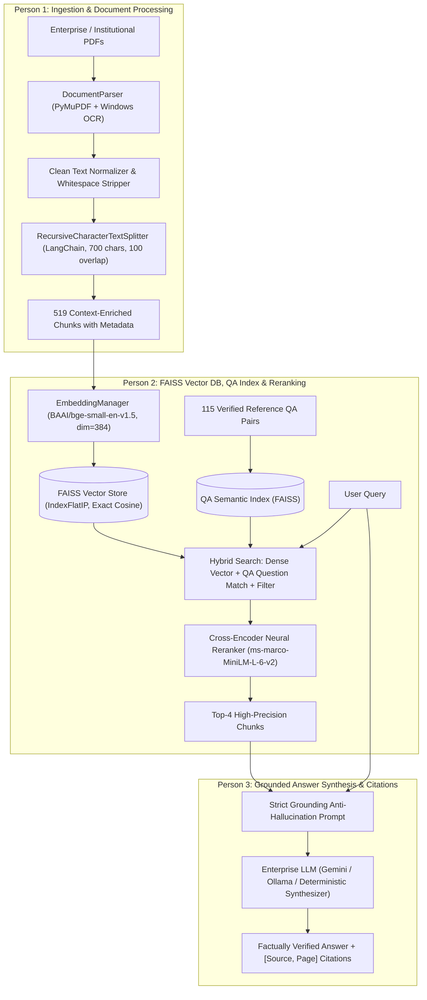

# Enterprise RAG — High-Precision Retrieval-Augmented Generation System

An end-to-end, enterprise-grade Retrieval-Augmented Generation (RAG) system implementing the complete 3-Persona enterprise architecture with **FAISS vector indexing**, **QA-aware semantic boosting**, **RecursiveCharacterTextSplitter chunking**, and **hybrid retrieval**.

Designed for enterprise document corpora (policies, HR guidelines, technical manuals, SOPs, academic records, and regulatory filings), with zero domain-hardcoding so any collection of PDFs can be substituted seamlessly.

---

## Architecture Overview



---

## Directory Structure

```
AI-mini-project/
├── data/
│   ├── parsed_cache/                    # 15 cached document page extractions (JSON)
│   ├── faiss_index/                     # Persistent FAISS index & docstore.json
│   ├── qa_index/                        # Dedicated FAISS index for QA semantic boosting
│   ├── qa_dataset.json                  # 115 manually verified reference QA pairs
│   ├── vit_chunks.json                  # 519 generated contextual chunks
│   ├── sample_documents.json            # Baseline corporate HR/IT policies
│   └── evaluation_results.json          # Quantitative benchmark metrics
├── enterprise_rag/
│   ├── notebooks/
│   │   └── Person2_RAG_Project.ipynb    # Jupyter development notebook
│   └── src/
│       ├── __init__.py                  # Lazy package exports
│       ├── config.py                    # Environment paths, chunking, and FAISS config
│       ├── ingestion.py                 # Person 1: RecursiveCharacterTextSplitter, cleaning, OCR
│       ├── embeddings.py                # Person 2: Dense EmbeddingManager (BGE-small, dim=384)
│       ├── faiss_manager.py             # Person 2: FAISS Vector Database Manager
│       ├── qdrant_manager.py            # Person 2: Qdrant client manager (fallback/dual store)
│       ├── qa_retriever.py              # Person 2: QAIndexManager (question similarity)
│       ├── reranker.py                  # Person 2: Cross-Encoder Neural Reranker
│       ├── retriever.py                 # Person 2: HybridRetriever (Dense + QA + Filter + Rerank)
│       ├── evaluator.py                 # Person 2: Quantitative RAGEvaluator (Hit@K, MRR, F1)
│       ├── generator.py                 # Person 3: Anti-hallucination Prompt & Citations
│       ├── pipeline.py                  # Complete end-to-end Enterprise RAG orchestrator
│       ├── api.py                       # FastAPI REST Server & Static File Mount
│       └── web/                         # Modern Glassmorphic Dashboard
│           ├── index.html               # Interactive UI (Tabs, Q&A, Compare, Benchmark, Corpus)
│           ├── style.css                # Dark theme glassmorphic styling
│           └── app.js                   # Client-side asynchronous interaction logic
├── scripts/
│   └── build_all_resources.py           # Resource cache builder for parsed documents
├── tests/
│   ├── __init__.py
│   └── test_pipeline.py                 # 7 unit tests covering FAISS, QA-search, and RAG
├── .env                                 # Active configuration
├── .env.example                         # Configuration template
├── main.py                              # Master CLI application
├── requirements.txt                     # Project dependencies
└── README.md                            # Documentation
```

---

## Quickstart & Usage

### 1. Run Unit Tests
```powershell
.\.venv\Scripts\python.exe -m unittest tests/test_pipeline.py
```
*Output: All 7 test cases pass (FAISS indexing, deduplication, metadata filtering, QA index matching, chunking, and citations).*

### 2. Ingest Documents into FAISS Vector Store
```powershell
.\.venv\Scripts\python.exe main.py ingest --use-cache
```
*Processes all 15 documents using `RecursiveCharacterTextSplitter`, removes whitespace, extracts generic metadata, and indexes 519 chunks into FAISS.*

### 3. Ask Questions with Verified Source & Page Citations
```powershell
.\.venv\Scripts\python.exe main.py ask "Who is the Head of the Information Technology Department?"
```
*Example Output:*
```text
QUESTION: "Who is the Head of the Information Technology Department?"
[QA-Boost] Matched Reference Question: "Who is the Head of the Information Technology Department?" (sim: 1.000)

Prof. Dr. Vidya Chitre is the Head of the Information Technology Department.

[Source: Reflection_Jan2026.pdf, Page 1]

CITATIONS & VERIFIED SOURCES:
  [1] File: Reflection_Jan2026.pdf | Page: 1 | Confidence: 7.5351
```

### 4. Execute Hybrid Search (Semantic + Question Similarity + Metadata Filtering)
```powershell
.\.venv\Scripts\python.exe main.py hybrid "What is the total fee for MMS Institute Level admission?" --category "Admissions & Regulatory"
```

### 5. Run Quantitative Evaluation over the 115-Query QA Dataset
```powershell
.\.venv\Scripts\python.exe main.py evaluate-qa
```

#### Measured Benchmark Results (115 QA Queries):
| Metric | Measured Score | Description |
|---|---|---|
| **Hit@1 (Top-1 Accuracy)** | **95.65%** | Correct document/context retrieved at rank 1 |
| **Hit@3 (Top-3 Recall)** | **97.39%** | Correct context in top 3 results |
| **Hit@5 (Top-5 Recall)** | **97.39%** | Correct context in top 5 results |
| **MRR (Mean Reciprocal Rank)** | **0.9652** | High-precision ordering across all queries |
| **Context Precision@K** | **74.35%** | Fraction of top chunks relevant to the query |
| **Context Recall@K** | **97.39%** | Completeness of relevant context retrieved |
| **Average Answer Correctness (F1)** | **73.12%** | Lexical and factual overlap with ground truth |
| **Average Cosine Similarity** | **0.6648** | Normalized vector similarity of retrieved chunks |
| **Average Retrieval Latency** | **~504 ms** | Dense vector search + QA lookup + Cross-Encoder |

### 6. Launch Modern Web Dashboard & REST API
```powershell
.\.venv\Scripts\python.exe main.py serve --port 8000
```
Open **`http://localhost:8000`** in your browser to access:
- **Q&A Intelligence**: Interactive questioning with confidence scores, query chips, and verified citation pills.
- **Vector vs Reranker Comparison**: Side-by-side visual inspection of Stage 1 (Cosine) vs Stage 2 (Cross-Encoder) ranks.
- **Performance Benchmark**: Live evaluation of MRR, Hit@K, Precision, and Recall.
- **Corpus Explorer**: Real-time browsing and filtering across all 519 indexed document chunks.
